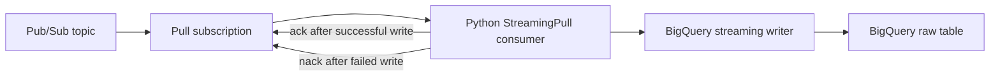

# Architecture

## Data flow

The consumer reads a configured subscription. It passes the message bytes and transport metadata to the BigQuery writer. The writer sends one row to the configured table. The consumer acknowledges only after BigQuery accepts the row.

## Raw table contract

The DDL creates a daily-partitioned table using `ingested_at`.

| Column | Type | Source |
|---|---|---|
| `payload` | `BYTES` | Original Pub/Sub message bytes |
| `message_id` | `STRING` | Pub/Sub message ID |
| `publish_time` | `TIMESTAMP` | Pub/Sub publish time |
| `attributes` | `JSON` | Pub/Sub message attributes |
| `ingested_at` | `TIMESTAMP` | Consumer receipt time |

The BigQuery streaming insert API represents `BYTES` values as base64 in its JSON request. BigQuery stores the decoded bytes. The application does not decode or inspect the message payload.

## Delivery and failure behavior

The worker provides at-least-once delivery. It nacks a message when BigQuery returns a write error. Pub/Sub can redeliver the message. The worker does not supply insert IDs and does not deduplicate rows. A failed acknowledgement after a successful insert can therefore create duplicate rows.

The initial Terraform configuration creates no dead-letter resource. The subscription uses Pub/Sub redelivery behavior. Add a dead-letter topic only after its retry limits, ownership, and alerting are approved.

## Infrastructure boundary

Terraform creates topics, pull subscriptions, BigQuery datasets, and a per-environment ingestion service account. It grants `roles/pubsub.subscriber` on each subscription and `roles/bigquery.dataEditor` on each dataset. The runtime host must attach this identity through its supported identity mechanism.

Terraform does not create BigQuery tables. `sql/tables/raw_message.sql` defines the table schema, and `scripts/apply_ddl.py` applies it for the configured pipeline.

## Environment configuration

Each environment YAML file is the shared source for project ID, region, topics, subscriptions, datasets, tables, and DDL references. The Python loader validates the values at startup. Terraform reads the same file to create the configured resources.
